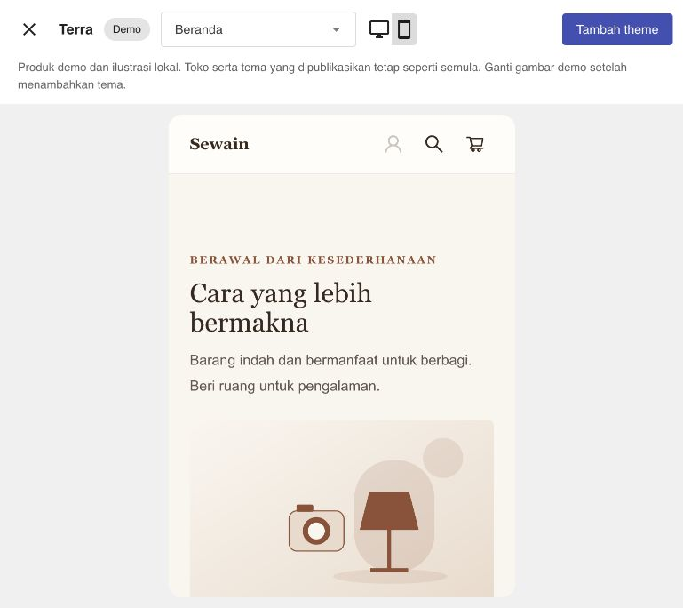
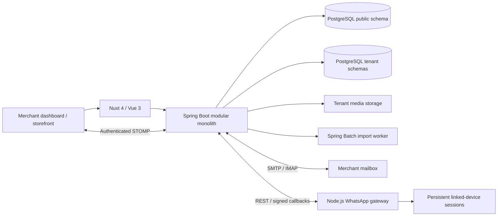

# Sewain

**A multi-tenant rental management application with a customizable storefront.**

Sewain connects the merchant's daily rental operations—products, physical inventory, bookings, returns and payments—with a customer-facing storefront. It is a full-stack portfolio project built with **Spring Boot, Nuxt, PostgreSQL and a Node.js WhatsApp gateway**.

[Local setup](docs/getting-started.md) · [Docker guide](DOCKER.md) · [Backend tests](docs/backend-business-unit-tests.md) · [Browser E2E](web/e2e/README.md) · [Third-party notices](web/THIRD_PARTY_NOTICES.md)

## Preview

Mobile storefront preview inside the theme editor, using demo content:



The screenshot shows the existing interface. Dashboard styling is maintained in the Sewain style layer; the current visual direction is retained.

## What the project covers

| Area | Capabilities |
| --- | --- |
| Merchant operations | Product variants, rental plans, physical inventory units, collections, customers and order management |
| Rental workflow | Package-based rental pricing, date-based inventory allocation, pickup/delivery details, return handling and late fees |
| Payments and finance | Manual payment records, deposit handling, refunds and financial summaries |
| Storefront | Block/section editor, theme library, authenticated previews, published snapshots and revision rollback |
| Bulk imports | CSV product imports through Spring Batch, multiple variants grouped by product slug, downloaded media and per-product failure reporting |
| Media | Tenant-scoped local storage, raster/static SVG handling and optional browser-side background removal |
| Integrations | Per-merchant SMTP/IMAP email and a separate WhatsApp Web session per merchant |
| Provisioning | Asynchronous merchant setup with STOMP progress and refresh/reconnect recovery |

## Engineering focus

### Tenant boundaries and asynchronous work

Merchant business data lives in separate PostgreSQL schemas. Shared identity and provisioning data live in the public schema. HTTP requests resolve the tenant and validate membership; asynchronous workers carry or explicitly set tenant context and clear it afterward.

New merchants receive tenant Flyway migrations and default settings before setup reaches READY. The browser follows provisioning through authenticated STOMP messages rather than polling.

### Rental pricing and physical inventory

Products describe the catalog; inventory units represent individual physical items. Availability and allocations operate on those units over rental periods. Pricing chooses a rental-plan combination and stores a snapshot, so later catalog changes do not rewrite the order's historical price.

Payment, refund and return workflows distinguish rental charges from refundable deposits. Business unit tests cover pricing, grace periods, order transitions, payment guards and inventory restrictions.

### Imports and integration boundaries

CSV import is a background Spring Batch job. Rows sharing a product slug form one product with multiple variants. A product and all its variants are committed together; a failed variant rolls back that product while other products can continue. Existing slugs are skipped rather than overwritten.

Outbound HTTP uses Spring RestClient. The media downloader retains dedicated public-address validation and download bounds. Email credentials are encrypted; gateway credentials remain server-side. WhatsApp callbacks are signed and incoming messages are deduplicated. Uncertain outbound delivery is recorded without automatic resend.

### Storefront publishing

The storefront editor works with a JSON component registry. Draft edits, authenticated previews and published snapshots have separate roles. Publishing and rollback preserve revision history; imported themes do not upload executable theme code.

## Architecture



The backend remains a modular monolith. The WhatsApp gateway runs separately because it owns the Node.js/Chromium session lifecycle. Root Compose connects the services and preserves database, media, key and gateway-session data in named volumes.

## Technology stack

| Layer | Technology |
| --- | --- |
| Backend | Java 21, Spring Boot, Spring Data JPA, Spring Modulith, Spring Batch, Spring Security, STOMP |
| Frontend | Nuxt 4, Vue 3, TypeScript, Pinia, Vuetify |
| Database | PostgreSQL 16, schema-based tenancy, Flyway |
| Integrations | SMTP/IMAP, REST, signed WhatsApp gateway callbacks |
| Tests | JUnit, Mockito, MockMvc, Playwright |
| Local deployment | Docker Compose and multi-stage images; native development is also supported |

## Run locally

### Docker

From the repository root, copy `.env.example` to `.env` **only if `.env` does not already exist**. Fill in `POSTGRES_PASSWORD`, `WHATSAPP_API_KEY` and the base64 32-byte `INTEGRATIONS_ENCRYPTION_KEY`.

```sh
cp .env.example .env
docker compose config --quiet
docker compose build
docker compose up -d
```

Open [http://sewain.app.localhost:3000](http://sewain.app.localhost:3000). The API uses host port 8080; PostgreSQL uses host port 5433. Register an account, create a merchant, and wait for store setup to finish.

### Without Docker

Use JDK 21, Node.js 22 and a local PostgreSQL installation. Run the backend with `./gradlew bootRun` and the frontend with `npm ci` followed by `npm run dev`. Native mode requires explicit database, API URL and origin configuration, and `SPRING_DOCKER_COMPOSE_ENABLED=false`.

The complete [setup guide](docs/getting-started.md) includes secrets, database initialization, environment exports, native WhatsApp/Chromium setup, a Docker-database-only alternative and troubleshooting. It also explains persistent storage and updating one service without rebuilding dependencies.

## Testing

Backend, from `backend/`:

```sh
./gradlew test
```

Frontend smoke tests, from `web/`:

```sh
npm run test:storefront
npm run test:product-tags
```

Browser E2E, from `web/e2e/`, after installing its isolated dependencies and Chromium:

```sh
npm test -- --project=desktop
```

Authenticated tests require a READY test merchant and environment credentials. A separate opt-in write suite creates a product with inventory, a manual collection and a pickup order through the UI. See the [E2E guide](web/e2e/README.md) for setup, visible-browser mode, reports and write-test prerequisites.

Tests are part of the project; this README does not claim that every suite passes on every environment. Database concurrency, external mailbox behavior and real WhatsApp delivery require additional integration verification.

## UI implementation and attribution

The dashboard uses Sewain's [style layer](web/app/scss/sewain/) and [navigation state](web/app/stores/dashboard-shell.ts) on top of Vuetify. Template-specific stylesheets, unused demo styles and the old customizer store have been replaced while retaining the existing layout, color palette and interface dimensions. Details and verification status are documented in the [dashboard style guide](docs/dashboard-style-system.md).

The project originally started from **[Mantis Free Vuetify Vue.js Admin Template](https://github.com/codedthemes/mantis-free-vuetify-vuejs-admin-template)** by **CodedThemes**. The retained visual direction and inherited code have that provenance; a stylesheet refactor does not erase it. The [MIT notice](web/licenses/MANTIS-MIT.txt) remains with the [third-party notices](web/THIRD_PARTY_NOTICES.md), alongside the bundled gateway and other asset/library acknowledgements. Third-party components retain their respective licenses; the Mantis license is not a blanket license for all Sewain code.

## Current scope and limitations

- Active development: this is a portfolio application, not a claim of production readiness.
- Payments are recorded manually; there is no implemented payment-provider integration such as Xendit.
- WhatsApp uses a WhatsApp Web gateway, not Meta Cloud API. The current connector supports direct text; groups, attachments and historical chat synchronization are outside its scope.
- Background jobs and gateway sessions currently assume a single backend/gateway deployment. Durable replay and multi-replica coordination remain future work.
- Docker configuration targets local use. Public deployment needs its own domains, HTTPS, infrastructure configuration and security review.

## Documentation

- [Setup with and without Docker](docs/getting-started.md)
- [Docker operations and persistent data](DOCKER.md)
- [Tenant setting initialization](docs/tenant-settings.md)
- [Storefront themes and publishing](docs/storefront-themes.md)
- [Product CSV imports](docs/product-csv-import.md)
- [WhatsApp integration](docs/whatsapp-integration.md)
- [Email/plugin integration architecture](backend/INTEGRATIONS.md)
- [Backend outbound HTTP standard](docs/backend-http-clients.md)
- [Business unit tests](docs/backend-business-unit-tests.md)
- [Frontend E2E](web/e2e/README.md)
