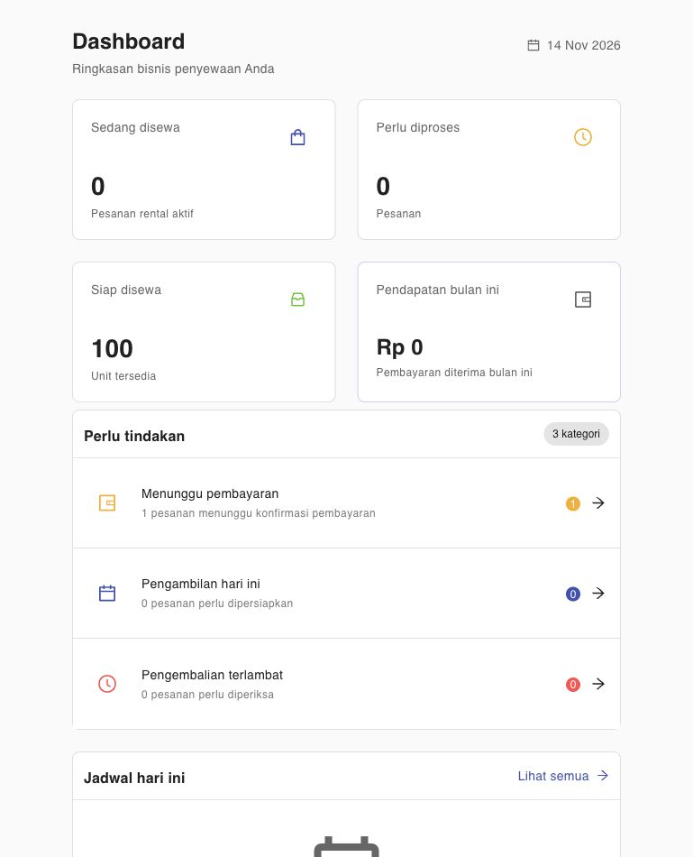
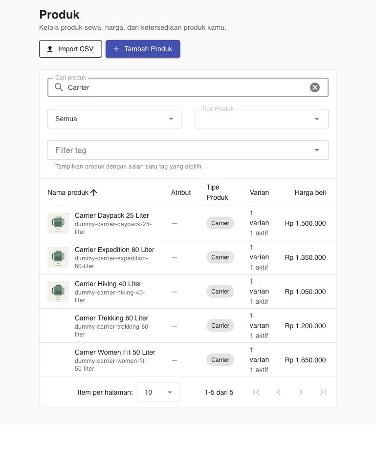
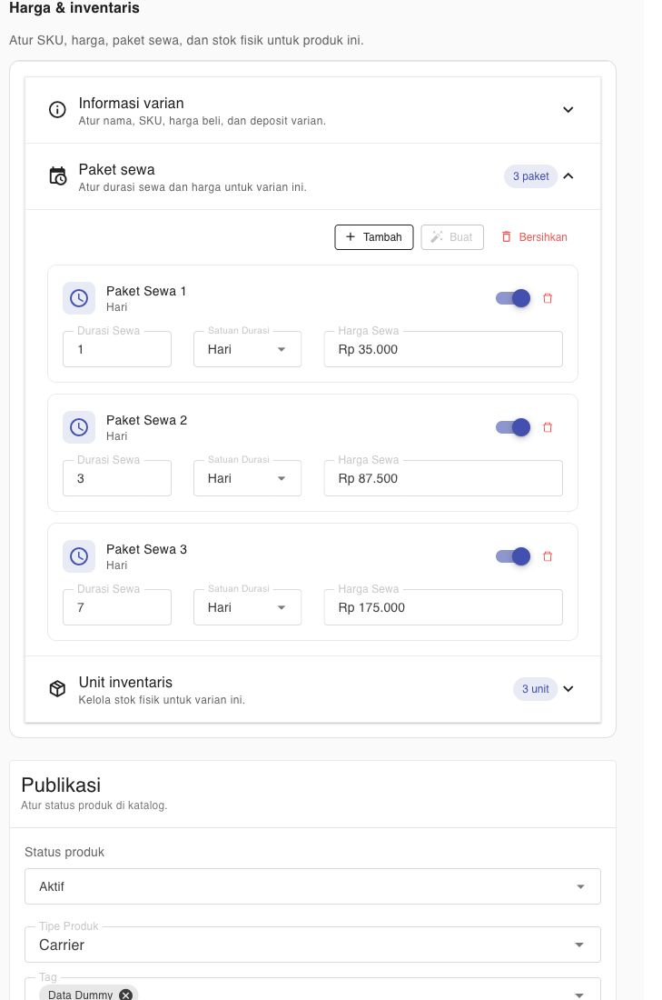
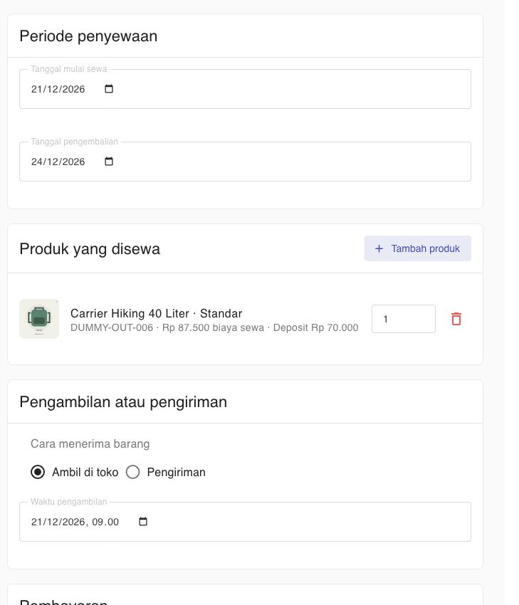
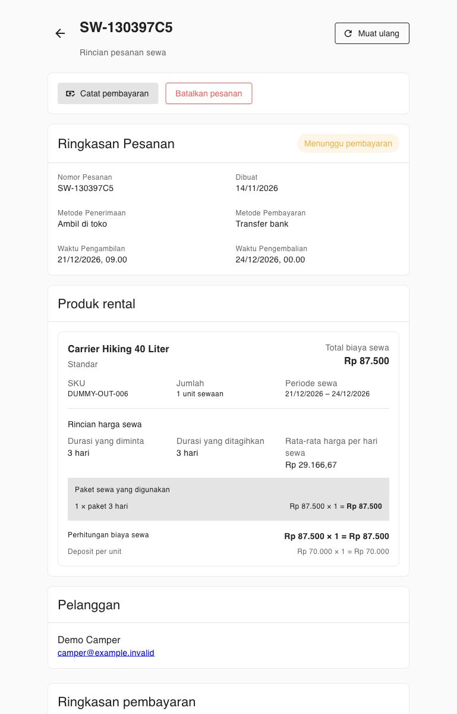
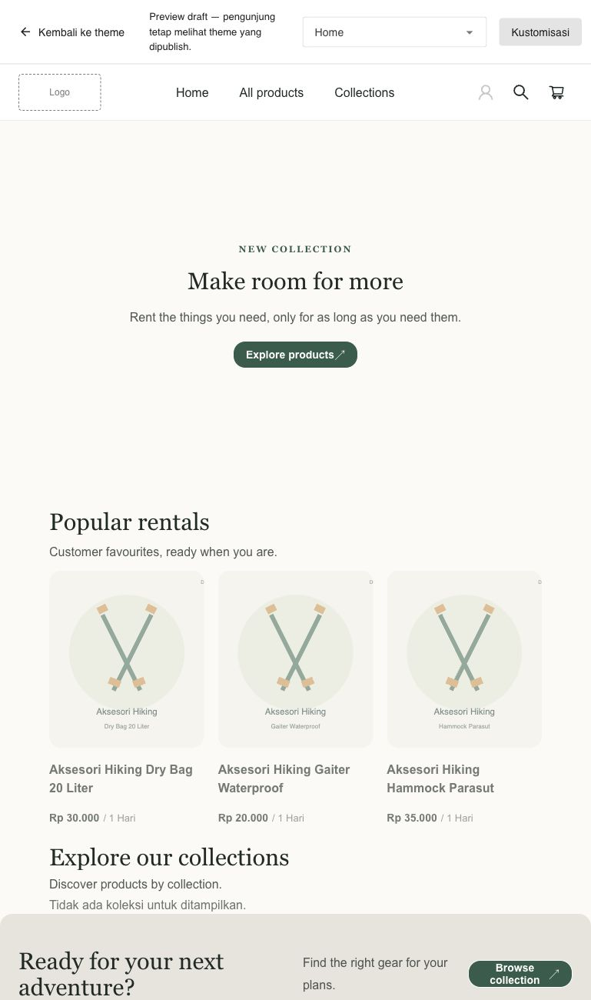

# Building Sewain.app Through Vibe Coding with ChatGPT and Luna

*From a conversational development process to a rental management application with tenant isolation, inventory allocation, a storefront editor, and automated tests.*

I built **Sewain.app entirely through vibe coding with ChatGPT, using the Luna model**. I described the behavior I wanted, asked for implementations, ran the application, brought errors back into the conversation, and kept refining the result.

The goal was to build a rental management application that could serve as a portfolio project while exploring the engineering behind a working product. A rental business needs more than a catalog and a checkout button. It needs to know which physical item is available, when it must return, how a rental should be priced, and how much of a payment is a refundable deposit.

That became the foundation of Sewain: a merchant workspace connected to a customizable storefront.

## Starting with the rental workflow

For the demo, I used an outdoor equipment store called **Eiger Rent**, populated with fictional products and customers. The catalog includes tents, carriers, sleeping bags, cooking equipment, lighting, and camping accessories.

The merchant dashboard provides an overview of rental operations and actions that need attention, including orders awaiting payment, pickups, and overdue returns. From there, a merchant can work with products, inventory, collections, customers, orders, finance, reports, storefront settings, and integrations.



*The dashboard is the starting point for the merchant's daily workflow.*

I wanted the application to reflect how rental inventory works. A product describes what customers can rent. A variant identifies a particular option. A physical inventory unit represents the actual item that leaves the store and needs to come back.

That distinction matters when a store owns three identical carriers. The catalog can show one product while the backend tracks each physical unit and its allocations over time.

## What is inside Sewain.app?

### A catalog with variants, rental packages, and physical inventory

Products support descriptions, media, tags, product types, variants, and publication status. Variants carry their own SKU, purchase price, deposit amount, rental packages, and inventory units.

Merchants can search and filter the catalog, group products into manual or rule-based collections, and manage the condition and availability status of physical stock.



*The demo catalog contains multiple carrier products, organized under a shared product type.*

Rental pricing is based on packages. For example, the **Carrier Hiking 40 Liter** product has these options:

| Duration | Rental price |
| --- | ---: |
| One day | IDR 35,000 |
| Three days | IDR 87,500 |
| Seven days | IDR 175,000 |

The pricing calculation can select a package combination for the requested period. A three-day booking therefore does not have to cost three times the daily rate. Orders also retain a pricing snapshot, so a later catalog edit does not rewrite the historical calculation.



*Rental duration and price are configured separately from physical inventory.*

### Orders that separate rental fees from deposits

The order workflow brings together the customer, rental dates, selected variants, quantities, pickup or delivery details, and payment terms.

For this article, I created a real demo order through the application interface:

- Product: Carrier Hiking 40 Liter, one unit.
- Rental period: December 21–24, 2026.
- Pickup: December 21 at 09:00.
- Rental fee: IDR 87,500 for the three-day package.
- Refundable deposit: IDR 70,000.
- Total: IDR 157,500.



*The merchant selects the rental window, product, quantity, and fulfillment method before saving the booking.*

The saved order, **SW-130397C5**, is awaiting payment. Its initial rental down payment is IDR 26,250, with the remaining rental balance due at pickup. No payment was recorded as received during this demonstration.

This separation is important: creating an order is different from receiving money, and a refundable deposit needs to remain distinguishable from rental income.

The application includes manual payment recording, refund handling, return workflows, late-fee calculations, and financial summaries. Those features extend beyond the pending-payment example shown here.



*The saved order keeps the rental period, package calculation, and deposit visible together.*

An interesting detail surfaced while preparing the screenshots: the first date I selected fell on a day the store was closed. The backend rejected it. I moved the booking to weekdays and submitted it again. Even preparing a demo becomes useful feedback when the application enforces its business rules.

### A customizable storefront

Sewain also has a customer-facing storefront with a block and section editor, a theme library, draft previews, published snapshots, and revision rollback.

The editor uses structured configuration and a component registry. Merchants can prepare changes in a draft and inspect them before publication. Imported theme configurations do not upload arbitrary executable theme code.



*This is a draft preview with demo illustrations and a placeholder logo; it has not been published as part of this walkthrough.*

### CSV imports and merchant-owned integrations

For larger catalogs, products can be imported from CSV through a background **Spring Batch** job. Rows sharing a product slug can form one product with multiple variants. The import can download product images into media storage and report failures per product.

A product and its variants are committed together. If that product fails, its changes roll back while other products can continue. Existing slugs are skipped rather than overwritten.

The current integration features include:

- **Email:** merchant-owned SMTP for outbound messages and IMAP for inbound messages.
- **WhatsApp:** a separate linked-device session per merchant, managed through a Node.js gateway based on WhatsApp Web.

The WhatsApp integration is a linked-device approach, not the official WhatsApp Business Platform. Live message delivery and mailbox behavior also need verification beyond mocked transport tests.

## The architecture behind the interface

The frontend uses **Nuxt 4, Vue 3, TypeScript, Pinia, and Vuetify**. The backend uses **Java 21 and Spring Boot**, with Spring Data JPA, Spring Security, Spring Modulith, Spring Batch, and STOMP.

The backend remains a **modular monolith**. This keeps deployment manageable while giving business modules boundaries that can be checked automatically. The WhatsApp gateway runs separately because it has its own Node.js and browser-session lifecycle.

PostgreSQL tenancy uses a shared public schema for identity and provisioning data, with separate schemas for merchant business data. Request handling resolves the tenant and checks membership. Background work must also carry the correct tenant context and clear it afterward.

New-store setup runs asynchronously. Flyway initializes the tenant schema and default settings, while the frontend receives provisioning status over authenticated STOMP messages. Persisted status allows the backend to answer again after a browser reconnect instead of relying only on a message that may have been missed.

Docker Compose connects the web application, backend, PostgreSQL, and WhatsApp gateway. Named volumes preserve database state, uploaded media, keys, and gateway sessions. Native development without Docker is supported too.

## How the vibe-coding process actually worked

The development process was conversational and iterative. I would describe a feature, examine the proposed behavior, try it locally, and bring back logs or screenshots when something failed. Follow-up requests narrowed the implementation: use STOMP instead of polling, standardize outbound HTTP on RestClient, preserve SVG uploads, or make dates display according to regional settings.

The work also involved plenty of ordinary debugging. A test stopped compiling after a controller gained a dependency. A filtered test command still compiled unrelated test classes. A selector clicked a hidden Vuetify input. A tenant migration needed more than one database connection. A frontend build failed while resolving a shared utility.

Each issue needed a concrete explanation and a verifiable correction. Generating a patch was only one part of that loop.

Vibe coding did not remove the need to make decisions. I still had to define the intended behavior, question assumptions, decide what belonged in scope, and check whether the result matched the workflow. The same applied to the interface: existing libraries and earlier template influences were part of the project's evolution, so I would not describe every visual element as an original design created from scratch.

## Testing became part of development

As the application grew, checking only the happy path in the browser was no longer enough. I added automated checks at several layers.

**Unit and lightweight tests** exercise pricing, deposits, late fees, payment and refund rules, order transitions, inventory restrictions, tenant access, settings, imports, media handling, and integration failures. They also include focused HTTP, filesystem, and module-boundary checks.

**PostgreSQL integration tests** use Testcontainers with real Flyway migrations, JPA mappings, and transactions. They cover tenant isolation, query behavior, rollback, concurrent requests for the last available unit, Spring Batch persistence, application startup, authorization, and STOMP recovery behavior.

**Frontend tests** include focused Node.js tests and Playwright suites for public pages, authenticated navigation, responsive layouts, and a write workflow that creates a product, collection, and order. These browser tests complement the backend checks; the backend result below does not claim a fresh successful run of every frontend suite.

The latest verified backend run on **November 14, 2026** produced:

| Suite | Tests | Failures / errors / skips |
| --- | ---: | --- |
| Default suite | 422 | 0 / 0 / 0 |
| PostgreSQL integration suite | 43 | 0 / 0 / 0 |

Combined JaCoCo coverage was **98.74% of lines and 85.48% of branches within the configured application-code scope**.

That scope matters. It measures services and selected business, validation, search, transport, and media classes. Entities, generated mappers, controllers, DTOs, and configuration outside the allowlist are not included in the percentage. Hibernate-generated entity methods are excluded through that class-level scope rather than tested just to increase a number.

The target is still 100% line and branch coverage for that scope. It has not been reached, and passing tests are not proof that every behavior is correct.

The main backend commands are:

```sh
# From backend/: default suite, no Docker required.
./gradlew test

# Real PostgreSQL integration tests; Docker required.
./gradlew integrationTest

# Both suites and combined coverage.
./gradlew jacocoCombinedReport
```

The 100% default-suite coverage gate is opt-in and separate from generating reports. I wanted the documentation to make that distinction clear rather than present a green build as evidence that the coverage target had been met.

## What this project taught me

The most valuable part of building Sewain through ChatGPT and Luna was being able to move between product ideas, implementation, debugging, and tests in one continuing conversation.

The difficult work remained in the details: separating a product from a physical unit, keeping a refund out of net income, carrying tenant context into a worker, preserving historical prices, and checking that a failed transaction leaves no partial booking behind.

Sewain is still an evolving portfolio application. The screenshots demonstrate a working catalog, rental pricing, order creation, and storefront preview. They do not establish production readiness, live integration reliability, or a completed payment and return lifecycle.

For me, the project is a practical record of what a fully vibe-coded application can become when implementation is followed by inspection, testing, and repeated correction. The next work is to close meaningful test gaps, improve the visual presentation, and verify more complete operational journeys with realistic demo data.
